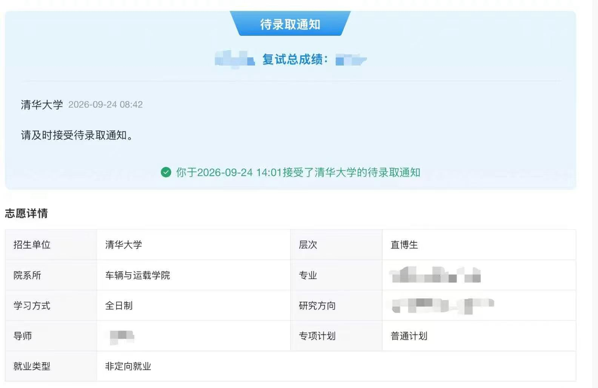
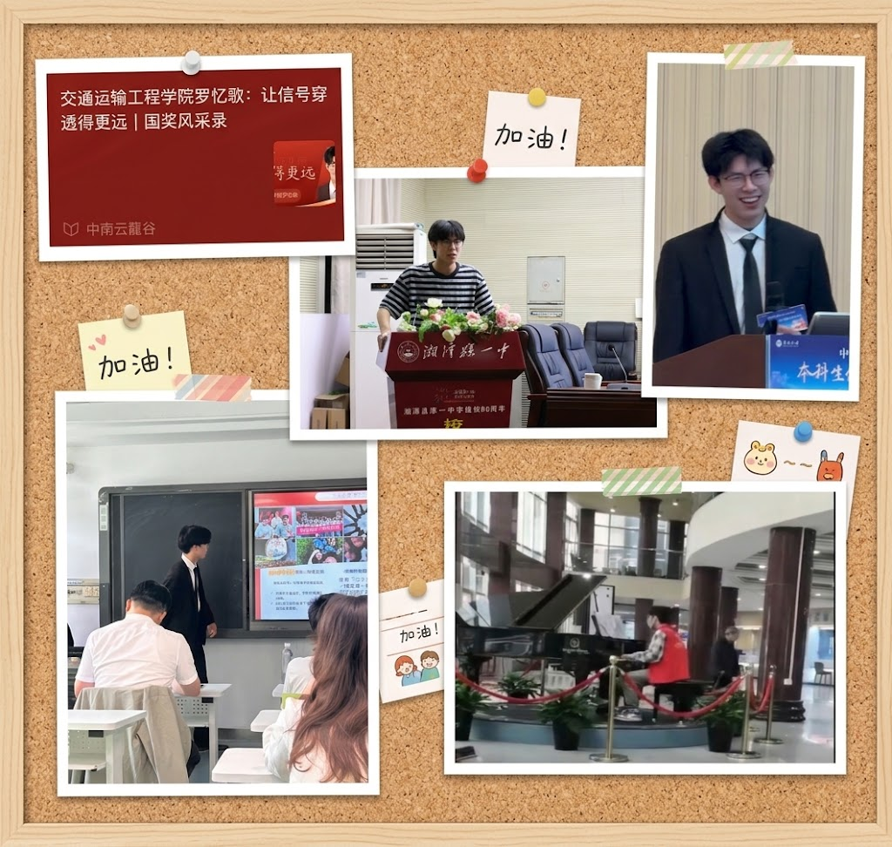
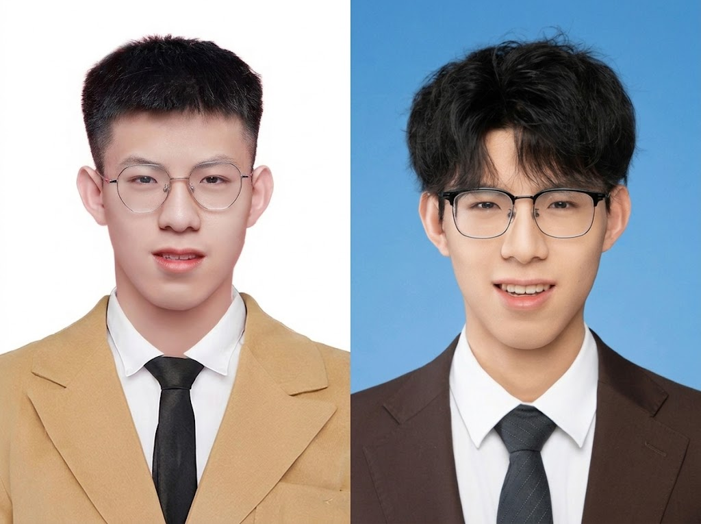

# 🫪👩‍❤️‍👨不要觉得可以一蹴而就

`自我高考结束，也确实过了三年了，三年看起来久但好像一下子也过了：从当初高考出成绩的晴天霹雳，到上了大学后，也越来越觉得无所谓了，到现在好像我的心气和自信慢慢又回来了。这篇博客的主要目的是想给自己过去的努力改变做一个总结（并不因为我获得的功利性的结果而产生，而是为我的成长“庆生”🤪）`

- 因为要讲的东西确实有点多，为了让我自己或者可能看到这篇博客的你思路更清楚，请跟着如下的顺序听我讲述：**三年的旅途总概**、**获得的成果或者能力**（我认为非常有用的🤭）、**不要觉得可以一蹴而就，体会完成的过程**、**未来我想做到的**（其实还没想好🫨）

# 1.三年的旅途总概

​	从2023年高考出成绩，我确定我完全是考砸了——630分，貌似将高中考的最差的那一次献给了高考，数学只有115分（平时还一直认为数学是最不会“背叛”我的学科😂），因为此，我确实有点不敢再见我的高中班主任。但其实现在看来我也确实只有这个分数的实力，一直喜欢“取巧”的我，面对事情或者现实的试卷，总想一蹴而就，以前我并不理解为什么很多老师都说我：聪明是聪明，就是太浮躁或者是沉不下心，可能就是不愿意“亲历”或者“完整享受”每一个过程（这里不细讲，之后再具体描述🙇🏼‍♂️）

​	具体讲，高中有点过于压抑了，有时候会觉得一天都没学什么学到很晚，实际上一点用也没有，也会焦虑晚上偷偷玩手机到很晚（这个时候看玄幻小说确实太爽了，正好满足这个时候觉得自己可笑的“雄心壮志”，觉得自己一直不一样、一直很聪明🤣），第二天上课就睡觉。而且过于看重结果不注重过程，我其实一直对于我那个时候特别在意月考的行为觉得很抽象，但其实这种月考成绩能有什么用呢，就算不考也没有什么用，但可能就是那个时候我就需要月考成绩来证明我很厉害、证明我认真学习了，因此我高中生活过的胆战心惊，但实际是没必要的（可能也和当时所处的大家互相竞争的环境有关吧，从我从一般的班转到我们学校最好的班的经验来看，卷出学习成绩好点的人确实都很压抑）

​	因为高考的表面失利，我也带着一股气来到了中南大学交通运输工程学院，同时我也愿意推荐所有还有很强烈的欲望想要往上走的人，中南大学交通运输工程学院是一个很好的能当作跳板的地方（可以之后想着躺平，专业可塑性也很强，之后能往各个方向申请），这里如果有想咨询的，可以直接和作者联系，这里不具体讲。因为带着一股劲，我也确实一直没有放松下来，没有被大学“摆烂”的趋势影响，可能也是因为高考给我打击太大了吧，我也确实在大学中获得了不错的成绩，大学中也成长许多（具体的下一 part 细讲）

- 前四、五、六学期专业第一

- 六级592分

- 连续两年获得国家奖学金

- 优秀学生标兵

  …………

​	因为这些资本，也因为很多很好的老师的帮助，最后我成功保研至清华大学车辆。

​	这里可以借用我朋友圈发过的文案：幸得良师引路，家人托底，挚友相伴，一路扶持，感念于心。学艺不精，继续取经！

>  这一刻我也确实有点恢复所谓的少年心气了，我就该站在高处，我就应该来到这个中国教育的顶点！

​	当我以清华直博生的角色回到我原来的高中宣讲时（当然也是被老师带着去的🤝），好像一切也无所谓了，但好像一切也都算数，可能高考也并没有想象的那么一定的决定命运，或许**你只需要在每个时间节点都努力一点**，比如高中努力上个985，大学再努力一点，选工作时又努力一点。前面的“只需要”可能也不够准确，这意味着你作为人的这根弦确实不能完全松下来，时代社会永远往前，我们也不能一蹴而就，慢慢来吧，终身努力，终身学习！

# 2.**获得的成果或者能力**

​	这一 part 就可以总结一下，或者可以参考的一些在大学需要会的技能或者能力。

- [ ] 学会答辩，学会包装自己、展示自己，锻炼自己的表达能力。

> 学会怎么展示自己，最高境界可能就是，可能没什么材料但是也能掷地有声的说服老师。这中间可能要多做 ppt ，学做 ppt 的同时也增强了审美，理顺了思路。学会了 ppt 其他的很多软件也能一通百通。

- [ ] 我感觉大学性价比最高的事，就是脸皮厚点主动去找老师，主动和老师聊天。

> 从非常功利的角度，让课程老师认识你，很大程度可以提高自己的课程平时分，其实很多时候，考试成绩会差不多，但是平时分会不一样，老师大概率认不全人，但是你去让老师认识，老师总要打几个平时分高的，那你就高了（平时上课的时候坐前排，下课去和老师讨论、问问题）从相对没那么功利的角度，向上社交，有时候老师的一句话可能比你努力很久管用（这里不细讲）

- [ ] 学会打扮自己，健身有一个相对匀称的身材。

> 有一个好的外貌，在任何时候都能带来便利（我确实没体验到）就算没什么作用，自己看着自己干干净净的，心里也是满足的。可以多去尝试一些风格（发型、穿衣等），找到最适合自己的风格。

> 这就是发型眼睛的变化，能有这么明显的改变

- [ ] 学会利用 ai 提高生活工作学习的效率

> 可以让 ai 做一些学习的思维导图、爬数据、总结知识点等工作

# 3.**不要觉得可以一蹴而就，体会完成的过程**

​	感觉这一点才是我真正想说的，我好像一直是一个很性急的人。但是是性急什么呢，大体是觉得我很想马上出结果。比如说做一类数学题，我会想着投机倒把，去做一些总结性规律性的结论，让我在考试的时候能够直接套用，类似于二级公式，或者比二级公式更加具体更加投机的方式。我一直在思考，这样做忽略了什么步骤，我感觉是忽略了完整应对一个未知问题的思考、研究过程，这导致我的应变能力、创造力、理解力一定程度得到了抑制，总想着走捷径，总想着跳过思考的过程。总觉得一蹴而就，之后的趋势就是不择手段的达到记过，但是事实证明有些结果不择手段也没用。忽略思考、研究、创造的过程，对于个人的心情能力都是一种阻碍，特别是心情，对于一直想要一蹴而就的人，最明显的特征可能就是总会焦虑于事情的发展。因为他们总希望马上产出结果，所以不能忍受产生结果的过程，但是产生结果的过程可能才是成长的过程，这样必然会缺失一部分成长的内容。就算侥幸到达了想要的结果，可能这个结果只是一个不稳的楼阁，日后还需要补上或者带来坍塌的风险。

​	未来面对事情，拿学校里选拔人为例子，不应觉得这是一个很简单的事，就觉得可以马上得到结果，一蹴而就。事实上正确的思路，应该是前期琢磨好选人的文件中的标准，后期好好精炼自己的材料等等。面对所有的事，有这种想把事情掰开揉碎了慢慢来的思想，我感觉不管什么时候你都不会觉得焦虑，因为我每一步都很扎实，何忧结果呢，就算结果不对，我反过来思考反思也行，我该做的都做了，已经完成我能做的了，剩下的也不是我能焦虑或能决定的了。（良好的心态可以带来美好的睡眠💤）

# 4. **未来我想做到的**

- [ ] 继续认识更多的人，尽量进行有效社交，尽量线下而非线上
- [ ] 我希望我的博士或者科研之旅能更加顺利，我能深入的研究某一特类（能让 ai 促进我这个方向，而非代替我这个方向）
- [ ] 能和 ai 的亲密度更高👩‍❤️‍👨
- [ ] 能锻炼自己独立处理事情的能力，不要被难题困住
- [ ] 保持良好心态，平常心🤩
- [ ] 继续保持**自信心**，有能力有精力解决所有问题
- [ ] ………………（暂时写累了，以后再加吧！）